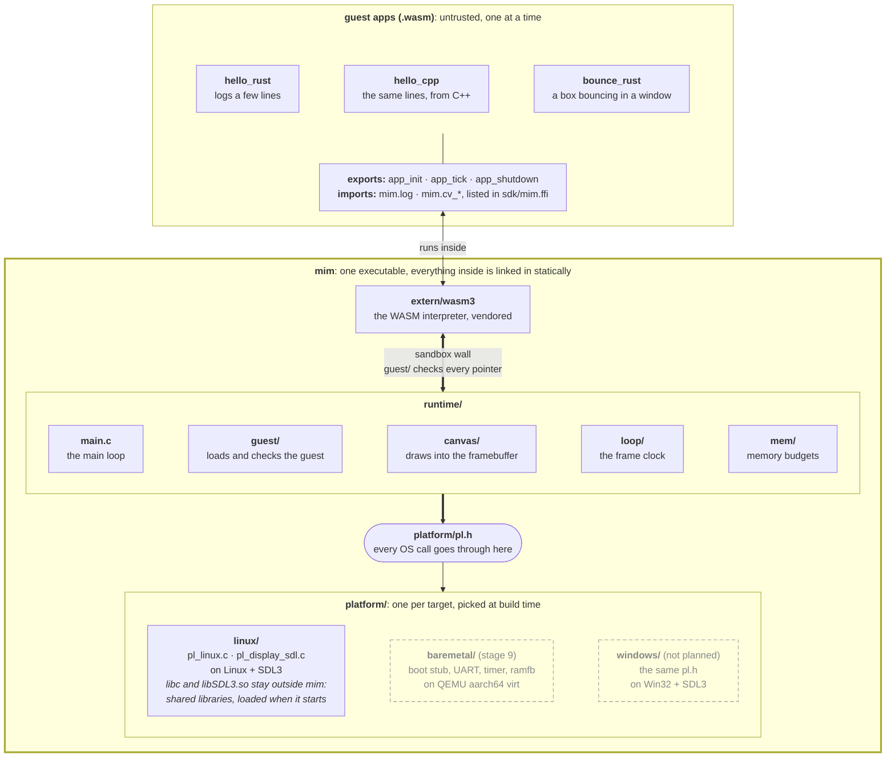
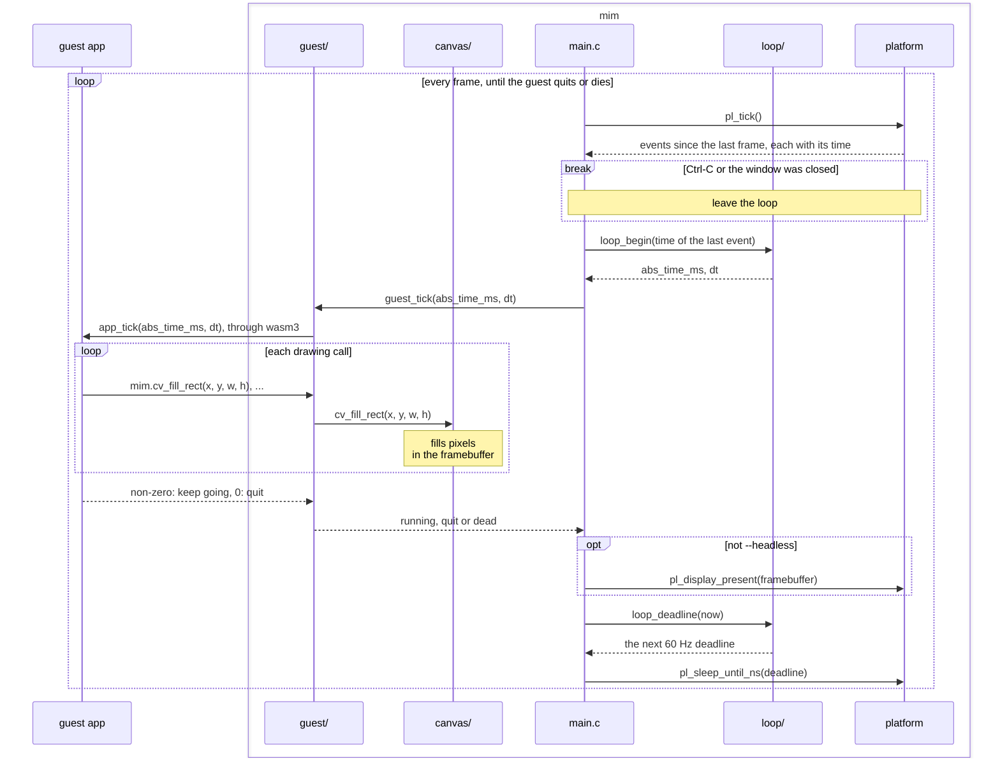
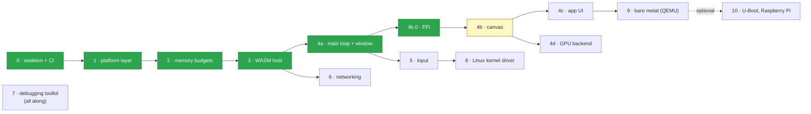

# MIM

**MIM Isn't M5.** A small media-app runtime, built from scratch one stage at a time to learn how
these things really work.

A C99 host runs apps compiled to WebAssembly (written in Rust or C++) in a 60 FPS loop. Every
OS-specific call goes through a thin platform layer, so the same host should one day boot on bare
metal with no OS at all.

## How it fits together



Everything in the big box is one executable, `mim`: `runtime/`, wasm3 and the platform layer
are static libraries linked into it. Only the guest apps (read at run time) and, on Linux, libc
and SDL3 (shared libraries) are outside it. Thick arrows cross a wall. Dashed boxes are planned,
not built yet.

- **The guest apps** are Rust or C++ compiled to WASM with `sdk/rust` or `sdk/cpp`, and the
  host doesn't trust them. They all have the same exports, which the host calls, and can only
  call back through the `mim.*` imports listed in `sdk/mim.ffi`. The host runs one at a time.
- **`extern/wasm3`** is the WASM interpreter that runs them, vendored with a small patch
  marked MIM. It calls the exports and hands each import call to `guest/`.
- **`runtime/`** is the host:
  - `main.c`: the main loop, one `app_tick` per frame, then show it.
  - `guest/`: loads the .wasm in wasm3, checks its exports, links the imports, and turns a
    guest crash into a dead guest instead of a dead host. The import glue, `ffi.h` and `ffi.c`,
    is generated from `sdk/mim.ffi` by [`tools/ffigen`](tools/ffigen/README.md), along with
    both SDKs' declarations; the handlers (`host_log`, `host_cv_*`) are written by hand.
  - `canvas/`: a 2D drawing API shaped like HTML5 Canvas, in software. It owns the framebuffer,
    and the guest's `mim.cv_*` calls draw straight into it, so no pixels cross the sandbox wall.
  - `loop/`: the frame clock, with 60 Hz deadlines and a `dt` for each frame. It makes no OS
    calls: it's handed the time, so a test can hand it any time it likes.
  - `mem/`: one big block of memory, split into fixed budgets.
- **`platform/pl.h`** is the whole OS interface. Nothing above it touches the OS.
- **`platform/<target>/`** implements it, one per target:
  - `linux/` is the only one so far: `pl_linux.c` does log, time, sleep, files, memory,
    threads, atomics, events and Ctrl-C; `pl_display_sdl.c` is the window (SDL3).
  - `baremetal/` is stage 9: the same apps on QEMU's aarch64 `virt` board, with no OS.
  - `windows/` isn't planned. It's there to show that a port is only a new `pl.h`
    implementation.

CI checks the walls: nothing outside `platform/` may include an OS header (`unistd.h`,
`pthread.h`, `SDL3/…`), and a set of hostile guests in `guests/evil/` try to break out of the
sandbox.

### One frame



The frame rate comes from the deadline, not vsync: on Wayland vsync doesn't behave like a clock.

### Memory

All memory is mapped once at startup, as one block, and split into named budgets that sit back
to back in this order. Going over one fails loudly with the budget's name, instead of quietly
eating its neighbour's memory.

| guest vm | guest linear | files | framebuffer |
|:---:|:---:|:---:|:---:|
| 8 MiB heap | 32 MiB bump | 4 MiB heap | 4 MiB bump |
| wasm3's own state | the guest's memory: one block that grows in place (`memory.grow`) | the `.wasm` file | 1280×720×4: what the canvas draws on |

## Stages

Each stage only counts as done when there's an automated test in CI that would fail if it broke.



| | Stage | What it is | Done when |
|---|---|---|---|
| ✅ | **0 · Skeleton + CI** | **CMake, clang-format, `-Werror`, a tiny test framework, GitHub Actions with sanitizers and Valgrind.** | **Every preset is green in CI.** |
| ✅ | **1 · Platform layer** | **`pl_*` for Linux: log, time, files, memory mapping, threads, mutexes, atomics.** | **Every function has a test, and a thread stress test passes under TSan.** |
| ✅ | **2 · Memory budgets** | **One block split into named budgets, with hand-written bump and free-list allocators, guard bytes and a leak report.** | **A fuzzer hammers alloc/free with no crash, and going over a budget fails loudly.** |
| ✅ | **3 · WASM host** | **wasm3 runs a Rust and a C++ app. The host checks the exports and every pointer the guest hands over.** | **Both apps give the same log, and hostile apps get rejected, not crashed into.** |
| ✅ | **4a · Main loop + window** | **A 60 Hz loop with a real `dt`, Ctrl-C and window close quit cleanly, the guest pushes 1280×720 frames into an SDL3 window (or runs headless), through `mim.present`, which the canvas replaced in 4b.** | **A fake-clock test checks every `dt` and frame, and bad `mim.present` calls trap.** |
| ✅ | **4b.0 · FFI** | **One table, `sdk/mim.ffi`, lists every import and shared constant. A small generator writes the host's linking code and both SDKs' declarations from it, and checks guest buffers before the handler runs.** | **Editing the table without regenerating fails CI, and a handler with the wrong argument types doesn't compile.** |
| 🚧 | 4b · Canvas | A 2D drawing API shaped like HTML5 Canvas, done in software: paths, fills, anti-aliasing, images, text from a glyph atlas. So far: the canvas owns the framebuffer, and guests draw with `mim.cv_fill_style` and `mim.cv_fill_rect`. | Golden-image tests per primitive, under 16 ms a frame. |
| ⬜ | 4c · App UI | A TV-style UI inside the guest: one state, actions, immediate-mode screens, D-pad focus, scrolling tile rows. Built in Rust and in C++. | A scripted "down, down, OK" replay matches a golden image. |
| ⬜ | 4d · GPU backend | A tiny `gpu_*` interface with an OpenGL ES backend. The software canvas stays as the reference. | Both renderers draw the same scene within a tolerance. |
| ⬜ | 5 · Input | Keyboard and gamepad events, plus an input thread feeding a lock-free ring buffer. | A multi-threaded stress test passes under TSan, plus an input replay test. |
| ⬜ | 6 · Networking | Non-blocking sockets, `poll()`, a hand-written HTTP/1.1 client, async callbacks to the guest. | Tests against a local server, and the response parser gets fuzzed. |
| ⬜ | 7 · Debugging toolkit | A crash handler with a backtrace, GDB and `perf` habits, and a bug diary. | At least 5 real diary entries, each with a regression test. |
| ⬜ | 8 · Linux kernel driver | `/dev/mim_pad`: a kernel module with a ring buffer of gamepad events. MIM reads input from it. | CI boots QEMU, loads the module, runs the test, and the kernel log stays clean (lockdep + KASAN). |
| ⬜ | 9 · Bare metal | The same `.wasm` apps on `qemu-system-aarch64 -M virt`: an assembly boot stub, UART, timer and `ramfb` drivers. | CI boots the image and finds the app's log lines on the serial port. |
| ⬜ | 10 · Extras (optional) | Boot through U-Boot, run on a Raspberry Pi, upstream a small fix. | — |

## Try it

You need CMake, Ninja, a C compiler, clang with `wasm-ld` (lld) for the C/C++ guests, Rust with
the `wasm32v1-none` target for the Rust guests, and SDL3.

```sh
rustup target add wasm32v1-none
cmake --preset debug
cmake --build build/debug

./build/debug/mim build/debug/guests/bounce_rust.wasm            # a box bouncing in a window
./build/debug/mim --headless build/debug/guests/hello_rust.wasm  # logs a few lines and quits

ctest --test-dir build/debug --output-on-failure
```

No display? `mim` says so and keeps running headless. Other presets: `clang`, `asan`, `tsan`,
`valgrind`, `fuzz`. Everything about the tests is in [docs/testing.md](docs/testing.md).

Changing what a guest can import: edit `sdk/mim.ffi`, run `cargo run -p ffigen`, and commit the
table with the files it rewrites. [tools/ffigen](tools/ffigen/README.md) has the steps.

## Where things are

```
platform/   pl.h (the whole OS interface) and its Linux version
runtime/    the host: main loop, guest loader, canvas, frame clock, memory budgets
sdk/        what an app links against: sdk/rust (the mim crate) and sdk/cpp (mim.h), and
            sdk/mim.ffi, the table every import is generated from
tools/      ffigen: writes the import glue for the host and both SDKs from sdk/mim.ffi
guests/     sample apps, plus guests/evil: hostile ones the tests throw at the host
tests/      one small executable per test, plus test_mim.sh for the real binary
extern/     wasm3, vendored with a small patch marked MIM
```
