# How the canvas works

The canvas is MIM's 2D drawing library. A guest app calls `fill_rect`, `arc`, `fill_text` and
friends; the canvas turns those calls into coloured pixels in a framebuffer. It is a **software
renderer**: ordinary C code on the CPU, with no GPU and no windowing library behind it.

This document explains it in three steps, each building on the last:

1. **[The idea](#1-the-idea)**: what the canvas is, where it sits, and how it is organised.
2. **[The data](#2-the-data)**: every buffer and table it keeps, and why each exists.
3. **[The pipeline](#3-the-pipeline)**: how a shape becomes pixels, step by step, with worked
   examples.

Each concept comes with a small example. The figures were drawn from the algorithm's own numbers,
and `tests/test_canvas.c` (`test_doc_examples`) checks that the real canvas produces the pixels
the examples show.

---

## 1. The idea

### 1.1 What it is

The canvas is shaped like the HTML5 `<canvas>` 2D API, so it will feel familiar if you have used
that:

```c
cv_fill_style(0xFF2F6FB5);          // colours are 0xAARRGGBB
cv_fill_rect(10, 10, 100, 50);      // a rectangle

cv_begin_path();                    // a path: build it, then fill or stroke it
cv_move_to(200, 20);
cv_line_to(260, 20);
cv_arc(230, 80, 30, 0, 3.14159f, false);
cv_close_path();
cv_fill();

cv_font_size(24);
cv_fill_text((const uint8_t *)"Hello", 5, 10, 150);   // UTF-8 bytes and a length; the one built-in font
```

These are the host's C functions. A guest calls the same things through its SDK (`mim::cv::fill_rect`,
and so on); each is one import that lands on the function of the same name.

It draws into a **pixel buffer** that the caller provides: `width × height` 32-bit values, each
`0x00RRGGBB`, rows from top to bottom. The canvas does not own the buffer, does not know about
windows, and does not decide when a frame is shown. It only changes pixels. Whoever owns the
buffer shows it (in MIM, the platform layer copies it to a window once per frame).

### 1.2 Where it sits

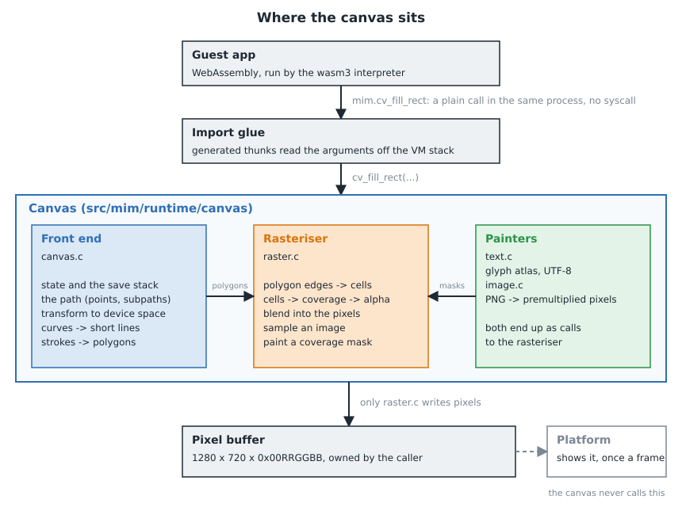

A guest app is WebAssembly, run by an interpreter. When it calls a drawing function, that is an
*import*: the interpreter calls a small generated C function (a "thunk") that reads the arguments
off the VM's stack and calls the canvas directly. It is an ordinary function call inside one
process, with **no system call** and no copying of pixels. The canvas then writes into the pixel
buffer, which is memory the host owns, not memory inside the guest.

Only one canvas is active at a time (`cv_set_context` picks it), because the imports carry no
canvas of their own to find another one by.

### 1.3 Why it is built this way

- **It is its own rasteriser, not a wrapper over a library.** SDL3's renderer has rectangles,
  one-pixel lines, textures and triangles, but no paths, arcs, line widths or anti-aliasing. A 2D
  canvas needs those, so the canvas computes pixel coverage itself.
- **It cannot depend on a window library anyway.** The runtime is not allowed to include SDL (CI
  checks this), a bare-metal target has no SDL, tests and headless runs need the pixels in plain
  CPU memory, and SDL allocates outside MIM's memory budgets.
- **It has one place that writes pixels.** Everything that appears on screen goes through three
  functions in `raster.c`. That keeps the rest of the canvas independent of how pixels are
  produced, and it is where a GPU backend would replace the CPU one.
- **It treats every argument as hostile.** The arguments come from a guest app that may be buggy
  or malicious. Section 1.5 lists the rules that follow from that.

### 1.4 Inside: three layers

| Layer | File | Job |
|---|---|---|
| **Front end** | `canvas.c` | Keeps the drawing *state* (transform, colours, clip) and the current *path*. Turns curves into short lines and strokes into polygons. Everything ends up as polygons in pixel coordinates. |
| **Rasteriser** | `raster.c` | Turns polygons into pixels: how much of each pixel is covered, then blend. Also samples images and paints coverage masks. The only code that writes the pixel buffer. |
| **Painters** | `text.c`, `image.c` | Text keeps a cache of rendered glyphs (an *atlas*) and paints them as masks. Images are decoded from PNG once and sampled when drawn. |

The front end speaks in **shapes**, the rasteriser in **coverage**, and the painters supply
ready-made coverage (glyphs) or ready-made pixels (images).

### 1.5 The rules it keeps

- **Everything is in device space after the first step.** A point is transformed by the current
  transform when it is added to a path, as in HTML, not when the path is filled. Moving the
  transform afterwards does not move a path already built.
- **Nothing a guest sends can break it.** A call with a NaN or infinite argument does nothing
  (HTML's rule). Every coordinate is clamped to ±2²⁰ (about a million pixels) before any
  arithmetic, so no float can overflow an integer. Limits (section 2.8) are fixed; a call that
  would exceed one returns `false`, and the runtime turns that into a trap that stops the guest.
- **No allocation while drawing.** All memory is taken from one memory budget in `cv_init`.
  After that, drawing never allocates (loading an image is the one exception; it allocates from
  the same budget).
- **The same input gives the same pixels.** No randomness, no timing, no threads. That is what
  lets the tests compare whole frames against stored images.

### 1.6 Which call touches what

| You call | It reads / changes |
|---|---|
| `cv_translate`, `cv_scale`, `cv_fill_style`, `cv_stroke_style`, `cv_line_width`, `cv_font_size`, `cv_clip_rect` | the **state** only |
| `cv_save`, `cv_restore` | the state, and the **save stack** |
| `cv_begin_path`, `cv_move_to`, `cv_line_to`, `cv_arc`, `cv_rounded_rect`, `cv_close_path` | the **path** (transformed on the way in) |
| `cv_fill` | path → **cells** → **pixels** |
| `cv_stroke` | path → **scratch** → cells → pixels |
| `cv_fill_rect` | cells → pixels (it does not touch the path) |
| `cv_image_load` | the **image table** |
| `cv_draw_image` | image table → pixels |
| `cv_fill_text` | **glyph atlas** → pixels |

The words in bold are the data, in the next section.

---

## 2. The data

### 2.1 Overview

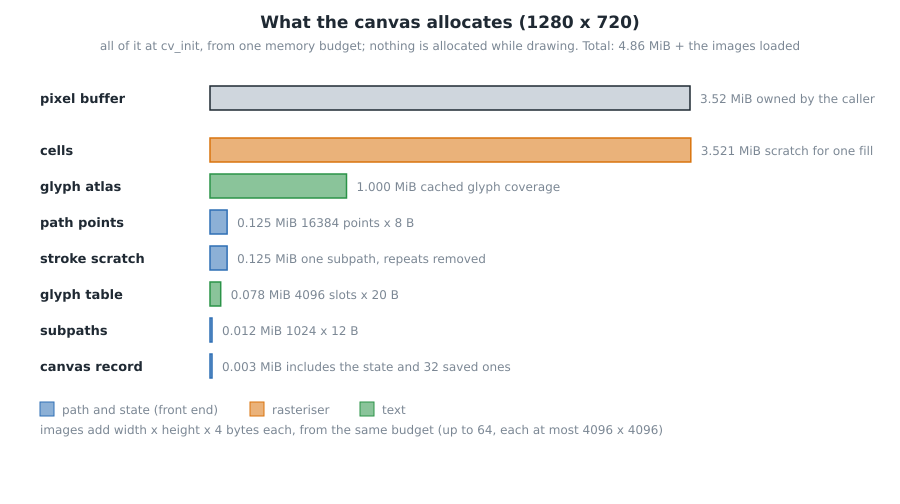

Nearly all of the canvas's memory is two things: the **cells** (the rasteriser's working buffer)
and the **glyph atlas** (the text cache). Everything else is small. All of it is allocated once,
in `cv_init`, from a single heap budget handed in by the caller; the sizes above are for a
1280 × 720 canvas. Cells grow with the canvas, the rest is fixed. Images are extra: each takes
`width × height × 4` bytes from the same budget.

### 2.2 The pixel buffer

`uint32_t *pixels`, `width × height`, one `0x00RRGGBB` per pixel; pixel `(x, y)` is
`pixels[y * width + x]`. The top byte is unused: the canvas blends colours onto what is already
there, so it never needs to store an alpha. The caller owns it and keeps it valid until
`cv_shutdown`. The canvas never clears it: whatever was drawn stays until it is drawn over.

### 2.3 State and the save stack

```c
typedef struct cv_state_t {
    float sx, sy, tx, ty;       // device = user * s + t
    uint32_t fill, stroke;      // 0xAARRGGBB
    float line_width, font_size;
    uint32_t clip_x0, clip_y0, clip_x1, clip_y1;   // whole device pixels: [x0, x1) x [y0, y1)
} cv_state_t;                   // 48 bytes
```

This is everything a drawing call looks up that is not an argument. The transform is only a
**scale and a translation** (no rotation or skew), which keeps rectangles axis-aligned and is
all a TV user interface needs. `cv_translate(x, y)` adds `x * sx` to `tx`, and `cv_scale(a, b)`
multiplies `sx` and `sy`, so they compose in the order they are called, as in HTML.

The state starts as: no transform, opaque black fill and stroke, line width 1, font size 10, and
the whole canvas as the clip.

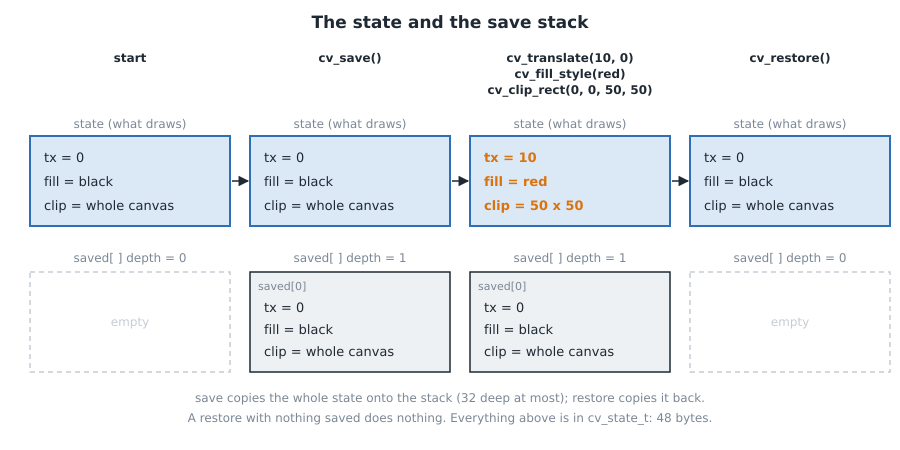

`cv_save` pushes a copy of the whole state onto a stack of 32; `cv_restore` pops it back. A UI
draws a widget like this: `save`, translate to the widget, set its clip and colours, draw,
`restore`; the next widget starts from a clean state without any bookkeeping. The clip can only
get smaller (each `cv_clip_rect` intersects with the current one), so `restore` is the only way
to widen it.

### 2.4 The path: `points` and `subpaths`

A **path** is a list of shapes waiting to be filled or stroked. It is stored as two flat arrays:

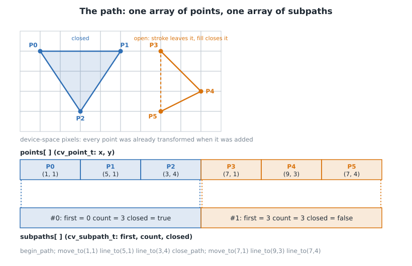

- `points[ ]`: every point of every shape, in order, as `(x, y)` floats **in device space**.
- `subpaths[ ]`: one record per shape: `first` (index of its first point), `count`, and whether
  it was `closed` with `cv_close_path`.

A **subpath** is one connected run of points. A `cv_move_to` starts a new one; `cv_line_to`,
`cv_arc` and friends extend the last one. The path above has two subpaths: a closed triangle and
an open V-shape. `cv_fill` fills both (an open subpath is closed by an implicit line back to its
first point); `cv_stroke` strokes the triangle all the way round, and the V only along its two
sides.

A few rules from HTML that this layer follows:

- A `move_to` directly after a `move_to` replaces it (a subpath of one lone point is dropped).
- After `close_path`, the next `line_to` starts a *new* subpath at the point where the closed one
  began.
- `cv_arc` adds its first point joined by a line to the current point, so an arc after a
  `move_to` draws a connecting line.
- `cv_begin_path` just sets both counts to zero. `cv_fill` and `cv_stroke` do **not** clear the
  path, so one path can be filled and then stroked.

The arrays have fixed capacity: 16384 points and 1024 subpaths. Going past either makes the
call return `false`. Curves count by the lines they become (section 3.3).

### 2.5 `scratch`

A second array of points, the same size as `points`, used by `cv_stroke` and nothing else. To
stroke a subpath, the code first copies its points into `scratch` **without consecutive repeats**
(two points closer than 0.001 px have no direction between them, and a direction is needed to
find the line's sides). It then works from that clean copy. The `points` array is left alone, so
the path survives the stroke.

### 2.6 `cells`

This is the rasteriser's working buffer, and the least obvious piece of data. It is a grid of
`float`s, **one per pixel plus two spare columns per row**: `(width + 2) × height`.

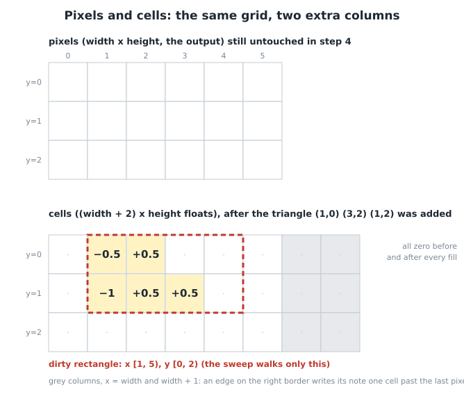

A cell holds a *note*: "the shapes' edges cross here, and add this much signed area". The
rasteriser first writes notes for every edge of a shape (step 4 of the pipeline), then sweeps
each row adding the notes up to learn how much of each pixel is covered (step 5). Section 3.4
explains why that works.

What to know about the buffer itself:

- **Zero between fills.** It is all zeros when a fill starts and all zeros again when it ends:
  the sweep clears each cell as it reads it. Nothing needs to wipe 3.5 MiB per shape.
- **Two spare columns.** An edge sitting on the right border of the canvas writes into the cell
  *after* the last pixel, and one past that. Without the spares, those notes would have to be
  special-cased.
- **The dirty rectangle.** While writing notes, the rasteriser keeps the smallest rectangle
  holding every cell it touched (`dirty_x0/x1`, `dirty_y0/y1`). The sweep only walks that. A
  20 × 20 button on a 1280 × 720 canvas sweeps 20 rows, not 720.
- **It is not output.** Nothing is ever read out of `cells` except by the next step of the same
  fill. Pixels only change in step 5.

### 2.7 Images and glyphs

**Image table.** `images[64]`: each slot holds a pointer to decoded pixels, a width and a height,
or `NULL` for a free slot. `cv_image_load` decodes a PNG (with the `stb_image` decoder, built for
PNG only), converts it to **premultiplied** `0xAARRGGBB` (the colour channels already multiplied
by alpha, which makes blending cheaper), and returns a handle: the slot number plus one, so 0
means "failed". The decoder allocates from the canvas's budget and refuses an image over
4096 × 4096 before decoding, so a malicious PNG cannot take more than the budget holds.

**Glyph atlas.** Text is the one thing that would be wasteful to compute every time: turning a
font outline into coverage is much slower than copying coverage. So the canvas renders each
glyph once and remembers it.

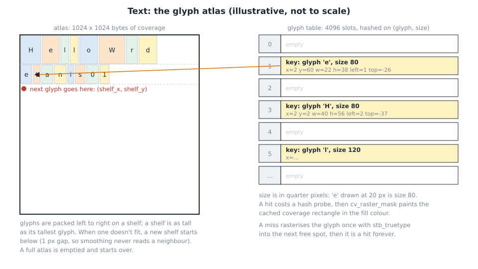

- The **atlas** is one big byte image (1024 × 1024), one byte of coverage per pixel. Glyphs are
  packed onto it in rows ("shelves"), left to right.
- The **glyph table** (4096 slots) is a hash table keyed by *(glyph, size)*, where size is in
  quarter pixels, so 20 px text is size 80. Each entry says where the glyph's coverage sits in
  the atlas, how big it is, and where it goes relative to the text cursor on the baseline.
- Drawing a glyph looks the key up. On a hit, it paints that rectangle of coverage in the fill
  colour. On a miss, it renders the glyph with `stb_truetype` into the next free spot first.
- The table is kept at most half full so lookups stay short. When it fills, or the atlas
  does, **everything is thrown away and starts over**. A frame full of text at many sizes will
  re-render a few glyphs once, then settle.

There is exactly one font, built into the binary, so the font data is always trusted: a guest
cannot supply a font file to the TrueType parser.

### 2.8 Limits

| Limit | Value | When exceeded |
|---|---|---|
| Points in the current path | 16384 | `false` (the guest traps) |
| Subpaths in the current path | 1024 | `false` |
| `cv_save` depth | 32 | `false` |
| Loaded images | 64 | `cv_image_load` returns 0 |
| Image side | 4096 px | `cv_image_load` returns 0 |
| Canvas size | up to 65536 × 65536 | asserts |
| Coordinates | ±1,048,576 | clamped |
| Text size | 256 px | drawn at 256 |
| Arc segments | 512 per arc | the arc is cut more coarsely |

---

## 3. The pipeline

### 3.1 Vocabulary

If you know graphics, skip to 3.2. Each term has one example.

**Pixel.** One square of the pixel buffer. Pixel `(3, 1)` is column 3, row 1, counting from the
top left. Its square covers `x ∈ [3, 4)` and `y ∈ [1, 2)`; its *centre* is `(3.5, 1.5)`.

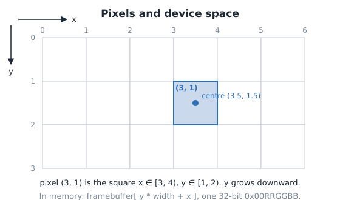

**Device space / user space.** User space is the coordinates the guest passes in. Device space is
pixels. The transform converts one to the other. After `cv_translate(10, 0)`, user `(0, 0)` is
device `(10, 0)`.

**Polygon.** A closed shape made of straight edges, given by its corners in order. The rectangle
`(1,1) (4,1) (4,3) (1,3)` is a polygon with four edges; the last runs from `(1,3)` back to `(1,1)`.

**Rasterisation.** Turning geometry (the numbers above) into a grid of pixel values: for each
pixel, *how much of it is inside the shape?*

**Coverage.** That answer, from 0 (none) to 1 (all) of the pixel's area. A pixel whose right half
is inside the shape has coverage 0.5.

**Anti-aliasing.** Using coverage as opacity instead of rounding it to 0 or 1. Without it,
diagonal edges look like staircases; with it, edge pixels are partly blended and the edge looks
smooth. The canvas computes the *exact* covered area, not a sampled estimate.

**Winding number.** Pick a point and a ray from it to infinity. Walk along the polygon's edges:
count +1 for each edge crossing the ray going down and −1 for each going up. The total is the
winding number. Outside a simple polygon it is 0; inside, ±1. Inside two overlapping shapes
wound the same way, it is ±2.

**Non-zero rule.** A point is *inside* if its winding number is not 0. This is the canvas's fill
rule, and HTML canvas's default.

**Blending.** Mixing a new colour into the colour already there by an alpha. Red (`0xFF0000`)
at alpha 128 over black gives a red channel of `(255 × 128 + 0 × 127 + 127) / 255 = 128`.

### 3.2 Overview

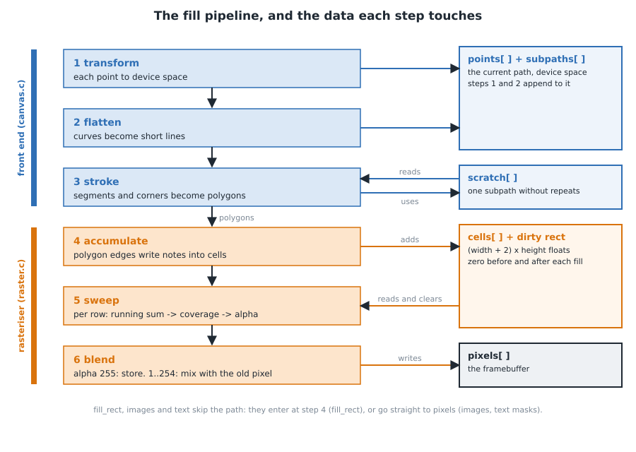

Six steps. Steps 1 to 3 (the front end) end with **polygons in pixel coordinates**. Steps 4 to 6
(the rasteriser) turn polygons into pixels. `cv_fill`, `cv_stroke` and `cv_fill_rect` all end up
in steps 4 to 6, which is why the rasteriser is small.

Not everything uses every step. `cv_fill_rect` has no path: it transforms its four corners itself
(step 1) and hands that one polygon straight to step 4. Images and text do not use `cells` at all (section 3.8).

### 3.3 Steps 1 to 3: from calls to polygons

#### Step 1: transform

Every point is converted to device space the moment it is added: `device = user × s + t`,
clamped to ±2²⁰.

*Example.* `cv_translate(10, 20); cv_scale(2, 2); cv_fill_rect(1, 1, 3, 2)`. The transform is
`sx = sy = 2`, `tx = 10`, `ty = 20`, so the corners `(1,1) (4,1) (4,3) (1,3)` become
`(12,22) (18,22) (18,26) (12,26)`. The order of calls matters: with the scale first and
the translate second, `tx` would be `10 × 2 = 20`, and the same rectangle would land at
`x = 22..28`.

#### Step 2: flatten

The rasteriser only knows straight lines, so curves are cut into short ones. How short? Short
enough that no point of the curve is more than a **quarter of a pixel** from the line segment
replacing it. For a circle arc of device radius *r*:

```
step     = 2 · acos(1 − 0.25 / r)       the largest angle one segment may span
segments = ceil(sweep / step)           (at most 512)
```

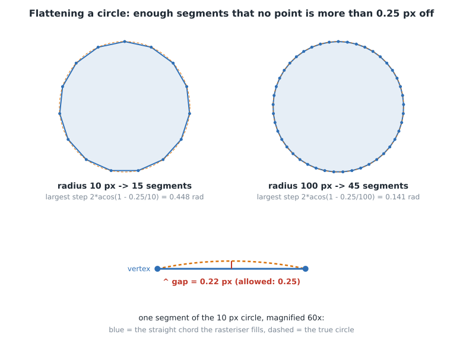

A radius-10 circle needs 15 segments and a radius-100 circle needs 45: a bigger circle bends
less per unit of length, so it can use a smaller fraction of its circumference per segment. After
flattening, a circle is just a polygon with 15 or 45 sides. `cv_rounded_rect` is four quarter
arcs joined by straight edges, the same way.

#### Step 3: strokes become polygons (stroke only)

The rasteriser can only fill, so `cv_stroke` builds the outline of a thick line out of polygons
and fills those:

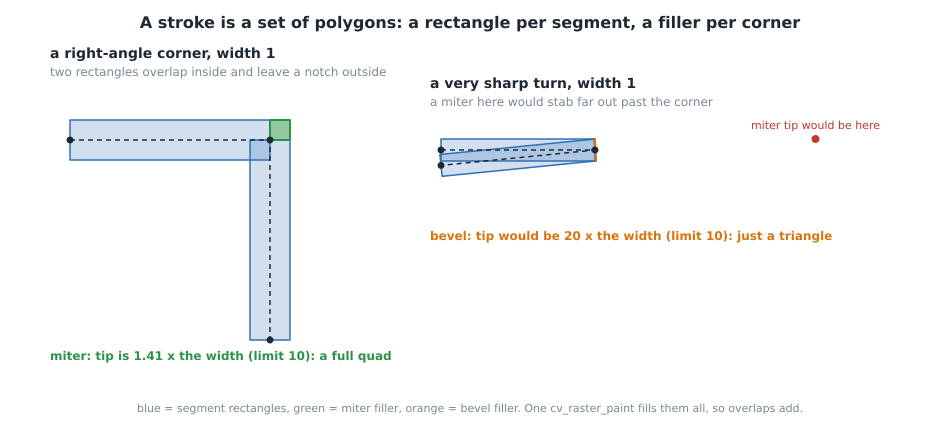

- **Each segment becomes a rectangle**, extended half the line width to each side of the segment.
  The line `(2,5)→(12,5)` with width 2 becomes `(2,6) (12,6) (12,4) (2,4)`.
- **Each corner gets a filler** on the outside of the turn, where the two rectangles leave a
  gap. A **miter** is a quad reaching out to the sharp point. If that point would stick out more
  than 10 line widths (the two segments meet at less than about 11°), the corner is **bevelled** instead: a
  triangle that just cuts it off. These are HTML's rules.
- All the polygons of one `cv_stroke` are added before a single paint, so they add up in the
  winding and a translucent stroke is not darker where its own pieces overlap.

Line ends are butt (cut square); round and square caps are not implemented.

### 3.4 Step 4: accumulate. Don't ask pixels, let edges tell rows

The obvious way to rasterise asks every pixel "are you inside?" That is 921,600 questions for a
full screen, each looking at every edge. The canvas does it the other way round, as font
renderers (`font-rs`, `stb_truetype`) do:

1. Each polygon **edge** walks down the rows it crosses and writes a *note* into `cells` in each
   row: "an edge is here, and it covers this much area to its right".
2. Each **row** is later swept once, left to right, adding the notes up. The running total at a
   pixel is its winding number, already weighted by how much of the pixel is covered.

Work is proportional to the edge lengths plus one pass over the rows touched. Pixels in the
middle of a shape cost nothing in step 4: they just inherit the running total.

Notes are signed. An edge going **down** adds `+d`, going **up** adds `−d`, where `d` is the
height it covers in that row (at most 1). Horizontal edges cross no row and leave no notes.

#### Example A: a rectangle on whole pixels, `fill_rect(1, 1, 3, 2)`

The corners are `(1,1) (4,1) (4,3) (1,3)`: x from 1 to 4, y from 1 to 3. It should cover
pixels `x = 1, 2, 3` on rows 1 and 2.

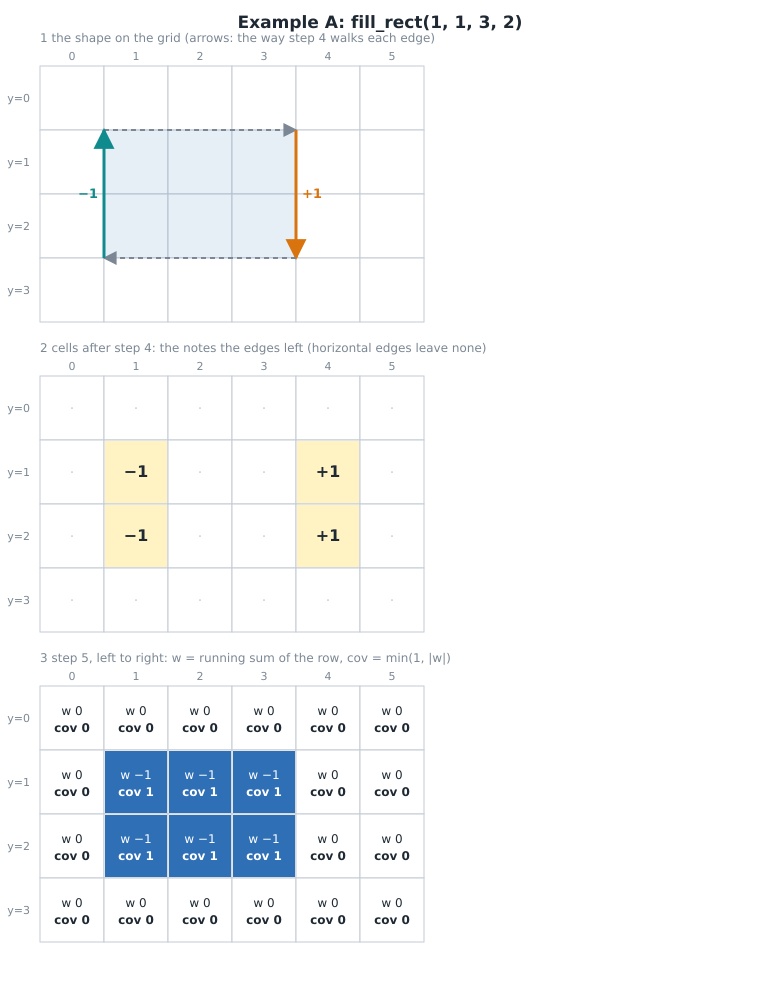

The right edge (at `x = 4`) goes down, so in rows 1 and 2 it adds `+1` to cell 4. The left edge
(at `x = 1`) goes up, so it adds `−1` to cell 1:

```
col:       0    1    2    3    4    5
cells:     0   −1    0    0   +1    0
```

In step 5 the running sum is `0 −1 −1 −1 0 0`. The left edge opened the shape (the total
jumped to −1), the right edge closed it (back to 0). Columns 2 and 3 have no note of their own:
they inherit −1 from their left neighbour, which makes a long interior free.

#### Example B: an edge inside a pixel, `fill_rect(1.5, 1, 2, 1)`

Now x runs from 1.5 to 3.5. Pixel 1 should be half covered (`1.5` to `2`), pixel 2 fully,
pixel 3 half (`3` to `3.5`).

An edge at a fractional x does not drop a whole `1` into one cell. It splits its note between the
pixel it is in and the one to its right, by how far into the pixel it is. The right edge, at
`x = 3.5` (halfway through pixel 3), adds `1 × 0.5` to cell 3 and `0.5` to cell 4.
The left edge adds `−0.5` to cell 1 and `−0.5` to cell 2.

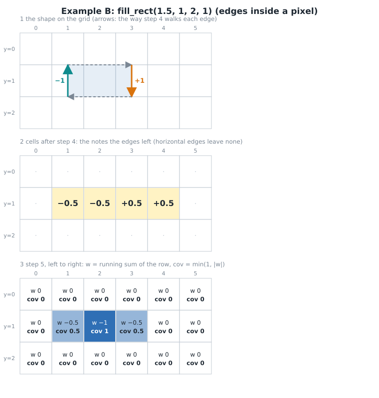

The sums are `−0.5, −1, −0.5, 0`: coverage `0.5, 1, 0.5`, exactly the covered areas. The reason
it works: a note says "from this pixel on, `d` of winding is added". An edge in the middle of a
pixel should add half to that pixel (it is half inside) and the other half to everything further
right. The running sum carries the rest.

#### Example C: a slanted edge, triangle `(1,0) (3,2) (1,2)`

A diagonal edge crosses a different x on each row, so each row gets its own note. The edge
`(1,0)→(3,2)` moves one pixel right per row: in row 0 it crosses pixel 1 (halfway: `+0.5`,
`+0.5`); in row 1 it crosses pixel 2 (`+0.5`, `+0.5`). The vertical edge going up adds `−1` at
column 1 in both rows.

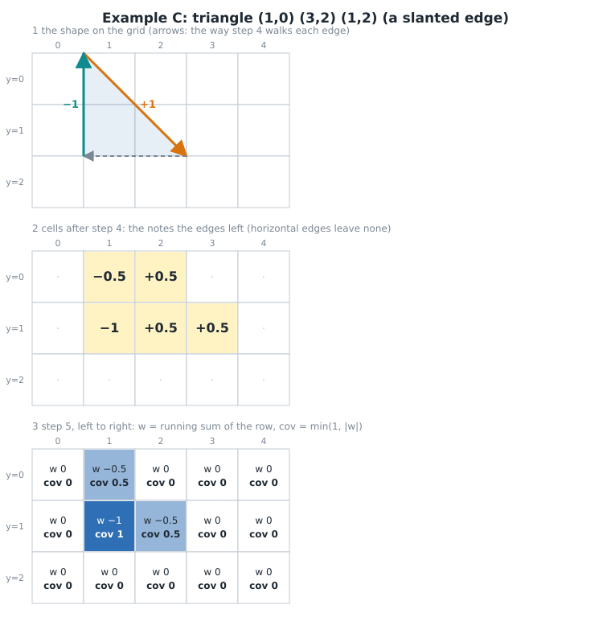

Check row 1, pixel 2 (`x ∈ [2, 3)`): the triangle there is the part left of the diagonal
`x = y + 1`. Over `y ∈ [1, 2)` that covers `x` from 2 up to `y + 1`, which averages half the
pixel. Coverage 0.5. ✓ An edge that crosses several pixels in one row (a shallow slope) spreads
its note over more cells, by the same area rule.

#### Example D: a shape partly off the canvas, `fill_rect(-3, 0, 5, 1)`

The left edge is at `x = −3`, off the canvas, but it still has to start the winding for
everything to its right. Before an edge is added, it is **cut where it crosses `x = 0` and
`x = width`**, and the parts outside are moved onto that border. Off the left, the edge becomes
an edge at `x = 0`. Off the right, a shape's winding affects no pixel, so nothing is needed.

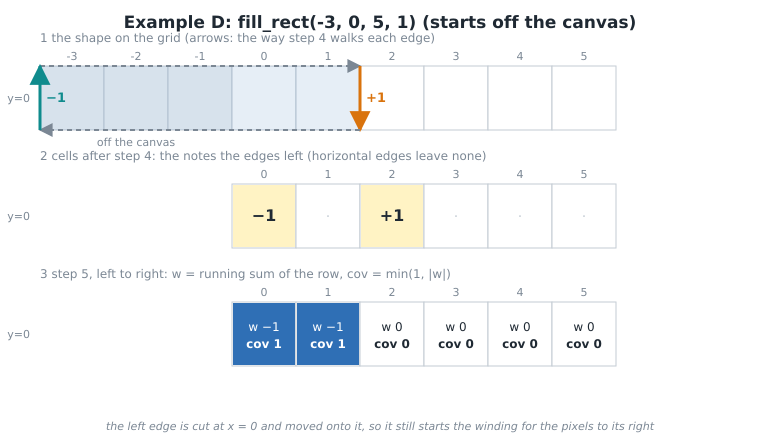

Without the cut, the edge's two endpoints would be clamped independently, and a slanted edge
would bend.

#### Example E: overlapping shapes, and why `min(1, |sum|)`

Two rectangles in one fill, `x = 0..4` and `x = 2..5`, overlap at `x = 2..4`:

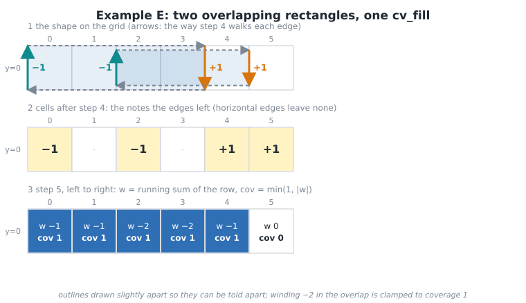

In the overlap the winding is −2, but a pixel cannot be more than fully covered, so the sweep
clamps it: coverage is `min(1, |winding|)`. That is the non-zero rule.

#### Example E2: direction matters

The same two rectangles, but the second subpath is wound the other way
(`(2,0) (2,1) (5,1) (5,0)`). Its edges now add `+1` on the left and `−1` on the right. The
overlap has winding −1 + 1 = 0: a **hole**.

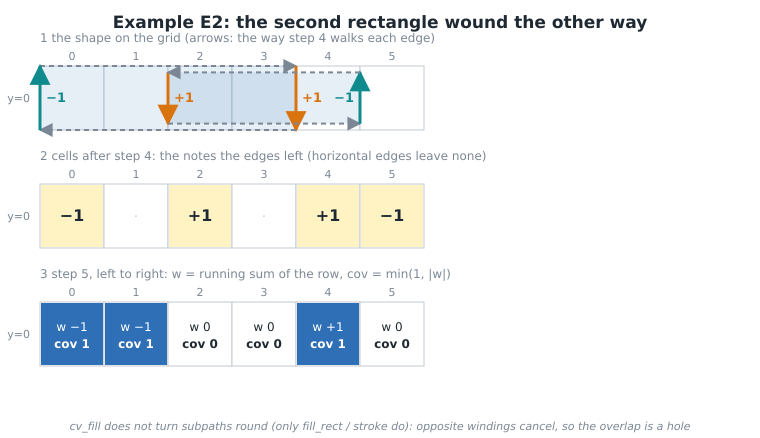

That is how a ring is drawn: an outer circle one way round and an inner circle the other.
`cv_fill` takes the subpaths exactly as the guest wrote them, so the guest's winding makes the
hole. `fill_rect` and strokes are different: they build polygons that are overlapping *pieces of
one shape* (the rectangles of a stroke), which must add up and never cancel. So they go through
`cv_raster_polygon`, which first reverses a polygon whose signed area is negative.

(The even-odd rule, which some APIs offer, would make every overlap a hole. The canvas has only
non-zero.)

### 3.5 Step 5: sweep and paint

For each row of the dirty rectangle, walk left to right keeping a running sum of the cells:

```
winding = 0
for each row y in the dirty rectangle:
    for x from dirty_x0 to the end of the row:
        if cells[x] != 0:                    // a note here: something changes
            winding += cells[x];  cells[x] = 0
            alpha = min(1, |winding|) * color_alpha
        paint pixel (x, y) with alpha        // no note: same alpha as the pixel to the left
```

Two details:

- Each row is walked in **three parts** because of the clip: left of the clip (cells are summed
  so the winding is right, but not painted), inside the clip (painted), and right of the clip
  (cells just cleared). Rows outside the clip were never written in step 4.
- After the last row, the cells are all zero again and the dirty rectangle is reset.

### 3.6 Step 6: blend

How a pixel is written depends on its alpha, 0 to 255 (coverage × the colour's alpha):

| alpha | what happens | cost |
|---|---|---|
| 255 | `out[x] = color & 0x00FFFFFF` | one store |
| 1 to 254 | read the old pixel, mix each channel, store | read + 3 mixes + store |
| 0 | nothing | none |

Interiors of an opaque fill are alpha 255 and take the fast path; only edges and translucent
fills blend. One channel mixes as `(src × a + dst × (255 − a) + 127) / 255`: a red channel of
255 at alpha 191 over 0 gives `(255 × 191 + 127) / 255 = 191`.

A full-screen opaque `fill_rect` is therefore 921,600 stores and no reads. This is the moment
pixels change.

### 3.7 What anti-aliasing buys

A triangle and a circle (radius 5.5 px) drawn by the real canvas on a 24 × 16 pixel buffer, each
pixel enlarged 14×. Left: the same frame with coverage rounded to 0 or 1. Right: what the canvas
produces. The grey pixels on the right are exactly the pixels with coverage between 0 and 1.

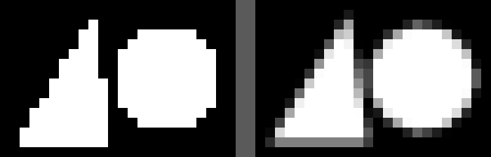

### 3.8 Images and text: pixels without cells

Images and text skip steps 1 to 5. Their coverage is already known, so they go straight to
pixels, inside the clip.

**Image** (`cv_draw_image`). The destination rectangle is transformed to device space; then for
each destination pixel inside it (and inside the clip), the canvas samples the source with
**bilinear interpolation**: the four nearest source pixels, weighted by how close the destination
pixel's centre falls. Then a premultiplied blend. The edges of the rectangle are cut at pixel
centres, not anti-aliased.

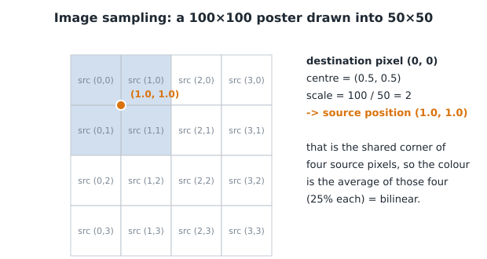

*Example.* Drawing a 100 × 100 image into a 50 × 50 rectangle: destination pixel `(0, 0)` has
its centre at `(0.5, 0.5)`, which maps to source position `(1.0, 1.0)`: the corner shared by four
source pixels. Its colour is the average of those four.

**Text** (`cv_fill_text`). For each UTF-8 character: find its glyph, add the font's kerning (the
adjustment between particular letter pairs), look the glyph up in the atlas (section 2.7), and
paint its coverage rectangle at the pen position in the fill colour (`cv_raster_mask`:
`alpha = mask × colour_alpha / 255`, then blend). The glyph *shapes* come in quarter-pixel sizes
while pen positions use the exact size, so a string is exactly as wide as `cv_measure_text` says.
A mask is "coverage, already computed".

### 3.9 What the algorithm gets wrong

- **Cancellation inside one pixel.** Within a single pixel, the areas from different edges are
  *added* before the absolute value is taken. If two shapes wound opposite ways meet inside one
  pixel, their areas partly cancel and leave a faint seam; if two shapes partly overlap in a
  pixel, the overlap is counted twice (a slightly heavy edge). UI shapes and glyphs do not do
  this. Exactness would need winding sampled at several points inside each pixel.
- **Separate fills have a seam.** Two anti-aliased shapes sharing a fractional edge are blended
  one after the other: at the edge, 50% A over the background, then 50% B over that, leaves 25%
  of the background showing. Browsers do the same. One `cv_fill` covering both shapes is
  seamless.
- **Clips are whole pixels** (rounded by pixel centres), so a clipped edge is not smooth.
- **Strokes** have butt ends and miter joins only.
- **One font, Latin only.** No shaping beyond kerning.

---

## 4. Reading the code

| To understand | Read |
|---|---|
| The public API and its limits | `runtime/canvas/canvas.h` |
| What the files share: the state, the path types, the implementation record | `runtime/canvas/canvas_impl.h` |
| State, path building, curve flattening, strokes | `runtime/canvas/canvas.c` |
| Edge accumulation (`cv_raster_line`, `line_inside`), the sweep (`cv_raster_paint`), blending, images, masks | `runtime/canvas/raster.c` |
| Text, the glyph atlas | `runtime/canvas/text.c` |
| PNG decoding | `runtime/canvas/image.c` |
| How a guest call arrives | `sdk/mim.ffi` (the table), `runtime/guest/ffi.c` (generated), `runtime/guest/host_cv.c` (the calls that can trap) |
| What the rules look like as tests | `tests/test_canvas.c` (rules on a tiny canvas; `test_doc_examples` holds this document's examples), `tests/test_golden.c` (whole frames against stored images) |
