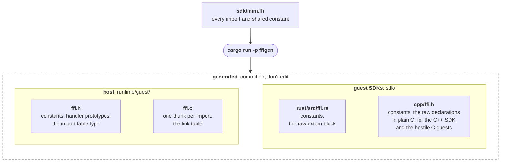

# ffigen

Generates the code on both sides of the guest/host boundary from one table, `sdk/mim.ffi`.

A guest calls the host through imports from WASM module `mim`. Each import needs a declaration
in every guest SDK and a host function that reads its arguments, checks them and links it
into wasm3. Written by hand, that's the same signature five times in three languages, and
nothing checks the copies agree until a guest loads. With ffigen the table holds it once, and
the copies are generated.



## Running it

```sh
cargo run -p ffigen
```

From anywhere in the repo. It reads `sdk/mim.ffi`, and either rewrites all four files or
writes nothing and lists every problem it found. The build doesn't run it: the generated
files are committed, so commit them together with the table.

## The table

One entry per line. `#` starts a comment.

```
# the size every guest draws at
const screen_width   1280
const screen_height  720
# a longer log line is cut
const log_max        200

# level: 0 debug ... 3 error
fn log      (level: u32, text: bytes)

include runtime/canvas/canvas.h
fn cv_fill_rect    (x: f32, y: f32, width: f32, height: f32) = cv_fill_rect
# how wide cv_fill_text would draw it, before the transform
fn cv_measure_text (text: bytes) -> f32 = cv_measure_text
```

- `const <name> <value>`: a constant both sides share. A non-negative integer that fits a C
  `int`.
- `fn <name> (<arg>: <type>, ...)`: an import, returning nothing.
- `fn <name> (<arg>: <type>, ...) -> <type>`: an import returning one number, any of the six
  number types. Never `ptr` or `bytes`: the host can't hand a guest its own memory.
- `fn ... = <host fn>`: an import the thunk does itself, by calling `<host fn>` with the same
  arguments, so there's no handler to write. Only for imports that can't trap, and never with a
  `ptr` argument, since nothing would check it.
- `include <path>`: a header `ffi.c` includes, declaring the functions `=` names.

Names are `lower_case`.

### Argument types

| Type | WASM values | The guest passes | The handler gets |
|---|---|---|---|
| `i32` `u32` `i64` `u64` `f32` `f64` | one | the number | the number |
| `ptr` | one `i32` | a pointer | a guest address (`uint32_t`), unchecked |
| `bytes` | two `i32`s | a pointer and a length | a host pointer and the length, already checked |

`bytes` is what makes the table worth having: the bounds check against guest memory is
generated, so a new handler can't forget it. Use `ptr` only when the size depends on other
arguments, such as an image's `width × height`, and check it in the handler with
`guest_mem_has`. No import uses it today.

### How each type comes out

For `fn log (level: u32, text: bytes)`:

```c
// runtime/guest/ffi.h: written by hand, see below
const char *host_log(const guest_mem_t *const mem, const uint32_t level, const uint8_t *const text, const uint32_t text_len);
```

```c
// runtime/guest/ffi.c
static const void *thunk_log(IM3Runtime runtime, IM3ImportContext ctx, uint64_t *sp, void *mem) {
    (void)ctx;
    const guest_mem_t m = {mem, m3_GetMemorySize(runtime)};
    const uint32_t level = *(const uint32_t *)&sp[0];
    const uint32_t text = *(const uint32_t *)&sp[1];
    const uint32_t text_len = *(const uint32_t *)&sp[2];
    if (!guest_mem_has(&m, text, text_len)) {
        return "mim.log: text outside guest memory";
    }
    return host_log(&m, level, m.base + text, text_len);
}
...
const guest_import_t guest_imports[] = {
    {"log", "v(iii)", thunk_log},
    ...
};
```

```rust
// sdk/rust/src/ffi.rs
#[link(wasm_import_module = "mim")]
unsafe extern "C" {
    pub fn log(level: u32, text: *const u8, text_len: u32);
}
```

```c
// sdk/cpp/ffi.h
__attribute__((import_module("mim"), import_name("log"))) void mim_log(uint32_t level, const void *text, uint32_t text_len);
```

A generated declaration with five or more parameters (on the host, `mem` counts) goes one
parameter per line, as clang-format keeps it. The thunk's call to the handler stays on one line.

### A result

For `fn cv_measure_text (text: bytes) -> f32`, the handler gets `result`, set to 0, to write into.
wasm3 keeps the result's slot first, so the arguments start at `sp[1]`, and the thunk only writes
the result if the handler didn't trap:

```c
// runtime/guest/ffi.h
const char *host_cv_measure_text(const guest_mem_t *const mem, const uint8_t *const text, const uint32_t text_len, float *const result);
```

```c
// runtime/guest/ffi.c
static const void *thunk_cv_measure_text(IM3Runtime runtime, IM3ImportContext ctx, uint64_t *sp, void *mem) {
    (void)ctx;
    const guest_mem_t m = {mem, m3_GetMemorySize(runtime)};
    const uint32_t text = *(const uint32_t *)&sp[1];
    const uint32_t text_len = *(const uint32_t *)&sp[2];
    if (!guest_mem_has(&m, text, text_len)) {
        return "mim.cv_measure_text: text outside guest memory";
    }
    float result = 0;
    const char *const err = host_cv_measure_text(&m, m.base + text, text_len, &result);
    if (err == NULL) {
        *(float *)&sp[0] = result;
    }
    return err;
}
```

The guests' declarations return it: `-> f32` in Rust, `float mim_cv_measure_text(...)` in C. Its
wasm3 signature is `f(ii)`.

### A direct call

For `fn cv_fill_rect (x: f32, y: f32, width: f32, height: f32) = cv_fill_rect` there's no
handler. The thunk calls the canvas itself, and the compiler checks the call against
`runtime/canvas/canvas.h`. Without a `bytes` argument it never looks at guest memory:

```c
// runtime/guest/ffi.c
static const void *thunk_cv_fill_rect(IM3Runtime runtime, IM3ImportContext ctx, uint64_t *sp, void *mem) {
    (void)ctx;
    (void)runtime;
    (void)mem;
    const float x = *(const float *)&sp[0];
    ...
    cv_fill_rect(x, y, width, height);
    return NULL;
}
```

A result is written straight into `sp[0]`.

Constants come out as `guest_<name>` on the host, `mim_<name>` in C and C++ guests, and
`<NAME>: usize` in Rust.

## What stays hand-written

- **The handler**, `host_<name>`, for every import without `=`, linked into `mim_guest`
  (`runtime/guest/guest.c` and `host_cv.c`). It does what the import does, and returns `NULL`, or a message that traps the guest. Its
  prototype is generated, so a handler with the wrong argument types doesn't compile.
- **The safe wrappers** in `sdk/rust/src/lib.rs` and `sdk/cpp/mim.h`, such as `mim::log` and
  `Line`. That's where the guest API gets designed, so they're better written by hand than
  generated.
- **Hostile guests that lie on purpose**, such as `guests/cpp/evil/wrong_import.c`, which keep
  their own wrong declarations.
- **The exports** (`app_init`, `app_tick`, `app_shutdown`), which are checked in `guest.c`.

## Adding an import

1. Add a `fn` line to `sdk/mim.ffi`.
2. Run `cargo run -p ffigen`.
3. Write `host_<name>`, unless the line ends in `=`. The compiler checks it against the
   generated prototype.
4. Add the safe wrappers to both SDKs.
5. For anything the handler checks itself, add a hostile guest in `guests/cpp/evil/`, its
   expected output in `tests/test_guest.c`, and a row in `docs/testing.md`. A `bytes` check
   is already covered by the generated code.
6. Commit the table and the four generated files together.

## What it rejects

Everything that would generate code that doesn't compile, or that the host would trip over:

- syntax errors, unknown types, and a `->` that isn't followed by a number type
- duplicate names, and argument names that clash: `x` twice, or `t: bytes` next to
  `t_len: u32`
- names the generated code uses itself (`m`, `mem`, `sp`, `ctx`, `runtime`, `result`, `err`), and C, C++ and
  Rust keywords (`int`, `this`, `type`, `_`, ...)
- more than 8 WASM values in one import: that's an import that wants a struct
- a constant that doesn't fit a C `int`
- `=` on an import with a `ptr` argument, or naming a keyword
- a table without any `fn`

Errors point at the problem:

```
ffigen: sdk/mim.ffi:1:
fn a (x: str)
         ^
expected i32, u32, i64, u64, f32, f64, ptr or bytes
```

## In CI

The `debug` job runs ffigen's tests, regenerates, and fails if `git diff` shows a change. That
catches a table edited without regenerating, and a generated file edited by hand.

```sh
cargo test -p ffigen     # parser and checks
```

## Not yet

Each gets added with the first import that needs it:

| Missing | Needed by |
|---|---|
| Buffers the host writes into | reading input events: the host fills a guest buffer |
| Structs crossing the boundary | the first import over 8 values (a rectangle is 4 `f32`s, so `cv_fill_rect` doesn't need one) |
| A type for handles to host objects | checking them in the generated code. Today an image is a plain `u32` from `cv_image_load`, which `cv_draw_image`'s handler checks itself |

## How it's built

Four files in `src/`:

- **`table.rs`, the table types.** An argument's type is `Scalar | Ptr | Bytes`. Also the checks
  the grammar can't express (keywords, reserved names, sizes).
- **`parse.rs`, parsing**, with [winnow](https://docs.rs/winnow) parser combinators, one entry
  per line, then a pass over the parsed entries for duplicates and the checks in `table.rs`.
- **`output.rs`**: one `fn(&Table) -> String` per file, with the C written as
  [indoc](https://docs.rs/indoc) `formatdoc!` templates. Each output is one small `match` from an
  argument to its parameters, and a function's parameters come from `flat_map`ping its arguments.
- **`main.rs`**: which output goes to which path, reading the table and writing the files.

Unit tests sit at the bottom of `parse.rs` and `output.rs`.

It's a workspace member, but not a default one: the guests' `cargo build --target
wasm32v1-none` builds the default members, and ffigen needs `std`.
